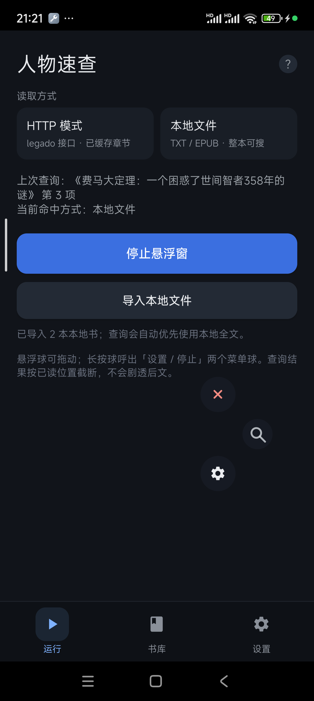
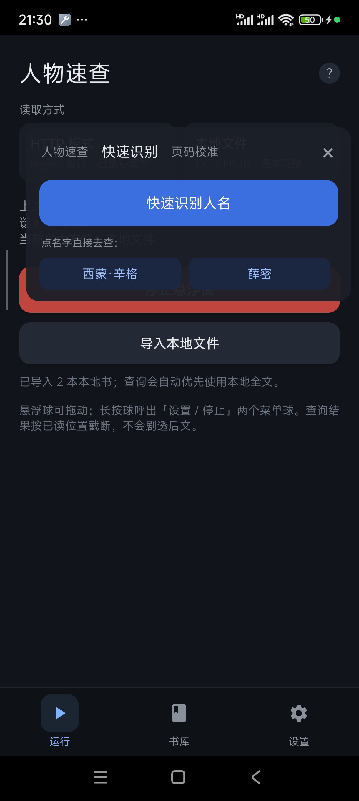

# Eread：面向 legado 的人物检索与档案生成工具

> 作者：Venus（启明星）　|　联系方式：QQ 3140661756　|　问题反馈：[Issues](https://github.com/Drscien/Eread/issues)

## 摘要

Eread 是一个独立的 Android 客户端，为开源阅读器 [legado](https://github.com/gedoor/legado) 提供人物检索与摘要能力。用户在阅读过程中通过悬浮控件输入人物名称，系统沿当前阅读位置向前检索，定位该人物首次出现的位置，并依据已读内容生成摘要与人物档案。

Eread 不修改 legado 的源代码，亦不内嵌其实现，仅通过 legado 提供的本地 HTTP 服务（默认 `127.0.0.1:1122`）读取书架、章节与阅读进度。二者在进程与数据层面相互独立。

## 1. 背景

长篇叙事文本，尤其是涉及西方历史、宗教、族谱或 transliteration 的文本，人物称谓密度较高，并普遍存在同名、简称、译名不一致等现象。读者在阅读过程中回溯某一人物身份与经历的代价较高，通常需要反复翻检前文。

现有阅读器的搜索功能以字符串匹配为主，返回结果缺少语义归纳；通用对话模型虽可承担摘要任务，但需要读者手动复制上下文，且难以约束"不剧透"这一阅读场景中的基本要求。

Eread 针对上述问题作了两点约束：其一，检索与生成均以当前阅读位置为上界；其二，位置以字符偏移而非页码表示，以避免分页参数变化导致的漂移。

## 2. 系统设计

### 2.1 位置模型

系统以 `chapter * 100000 + offset` 表示全局位置。章节内偏移由 legado 接口提供；页码仅作为展示层的估算值，由字符数与校准锚点推算，不参与检索与缓存判定。

### 2.2 检索策略

查询自当前章节向前反向扫描，逐章获取正文并匹配人名。命中片段按距当前位置由近及远取样，作为摘要与展示的上下文。扫描范围设有上限，达到上限时在结果中标注。

### 2.3 摘要模式

依据当前阅读位置与已有档案的关系，系统在三种模式间选择：

| 模式 | 触发条件 | 行为 |
| --- | --- | --- |
| 最新 | 无既有档案 | 自首次出现位置生成至当前位置的摘要 |
| 增量 | 当前位置晚于档案记录位置 | 仅对新增区间生成摘要，并合并至既有内容 |
| 回读 | 当前位置早于档案记录位置 | 生成阶段性摘要，不修改既有"最新"档案 |

同一位置重复查询直接返回缓存结果，不产生模型调用。

### 2.4 数据来源

- **接口模式**：通过 legado Web 服务读取已缓存章节；适用于未导入本地文件的书籍。
- **本地模式**：导入 TXT 或 EPUB 后，将正文归一化为 UTF-8 并建立章节索引，检索在本地全文上进行，覆盖范围优于接口缓存。

两种模式共存，查询时优先使用本地全文。

### 2.5 输出与导出

档案可按书导出为 ZIP 压缩包，内含整书档案、单人档案与元数据，支持 TXT 与 DOCX 两种格式；亦可经系统分享接口发送至其他应用。

## 3. 功能

- 悬浮控件检索：可拖动的悬浮球，点击展开查询面板，长按呼出设置与停止入口
- 首次出场定位与原文片段展示，片段可跳转至 legado 对应位置
- 三种摘要模式与位置缓存
- 快速识别：对当前页正文进行人名抽取，结果可直接用于检索
- 人物档案：最新概述与传记式详细档案，按四档重要性设定字数上限，上限随已读篇幅缩放
- 本地导入：TXT / EPUB，支持编码探测与章节切分
- 页码估算与校准
- 数据管理：本地书与接口书统一列表，支持多选导出、分享与删除
- 用量统计：按功能记录 token 消耗与估算费用，可查询模型账户余额
- 主题：深色与浅色

## 4. 安装与配置

运行环境：Android 8.0（API 26）及以上。

1. 自 [Releases](https://github.com/Drscien/Eread/releases) 下载并安装 APK。
2. 在 legado 中开启 Web 服务（我的 → Web 服务），确认端口，默认 1122。
3. 在 Eread 的"设置"中确认端口，填写模型 API Key 与接口地址。
4. 返回"运行"页启动悬浮窗，授予悬浮窗权限。

## 5. 使用

1. 在 legado 中打开书籍并定位至目标页。
2. 点击悬浮球，输入人物名称（不少于 2 字），提交查询。
3. 查看摘要与原文片段；点击片段可跳转回 legado。
4. 同一书籍中再次查询同一人物时，系统依据位置关系选择缓存、增量或回读模式。

辅助入口：

- **快速识别**：无需输入名称，对当前页做人名抽取。
- **页码校准**：填入阅读器底部页码，改善后续页码估算。
- **数据页**：长按条目进入多选，可导出、分享或删除档案。

## 6. 构建

依赖 JDK 21 与 Android SDK（compileSdk 36）。

```bash
cd standalone
./gradlew assembleDebug
```

产物位于 `app/build/outputs/apk/debug/app-debug.apk`。

## 7. 目录结构

```
standalone/app/src/main/java/com/eread/companion/
├── OverlayService.kt      悬浮窗服务：控件、面板、查询状态机、跳转
├── PanelView.kt           查询面板（速查 / 识别 / 校准）
├── BallView.kt            悬浮球绘制
├── LegadoApi.kt           legado Web 服务客户端
├── Searcher.kt            接口模式回溯检索
├── LocalSearcher.kt       本地全文检索
├── BookImporter.kt        TXT / EPUB 导入与章节索引
├── Llm.kt                 模型调用与提示词
├── BiographyBuilder.kt    详细档案生成：分段提炼、归并、成文
├── BookState.kt           人物档案、位置与回读缓存
├── PageEstimator.kt       页码估算
├── BookExporter.kt        导出 ZIP（TXT / DOCX）
└── ...                    界面与设置
```

## 8. 截图

| 悬浮面板 | 快速识别 | 人物档案 |
| --- | --- | --- |
|  |  |  |

## 9. 隐私与数据

书籍、人物档案、位置与缓存均存放于应用私有目录；应用不设服务端，不作数据上报。仅当用户主动发起查询、识别或档案生成时，相关原文片段会发送至用户自行配置的模型接口。Eread 对 legado 的数据仅作只读访问。

详见 [PRIVACY.md](PRIVACY.md)。

## 10. 已知限制

- 页码为估算值。legado 的分页依赖字体度量与内部排版参数，客户端无法完全复现，故页码仅供定位参考。
- 摘要与档案由模型生成，可能存在事实错误或遗漏，应以原文为准。
- 依赖 legado Web 服务；服务未开启或端口不符时无法读取书籍信息。
- 详细档案采用分段生成，篇幅较长的书籍耗时可达数分钟，且产生相应的 token 开销。

## 11. 许可

[MIT](LICENSE)。legado 为独立开源项目，与本项目无隶属关系。
